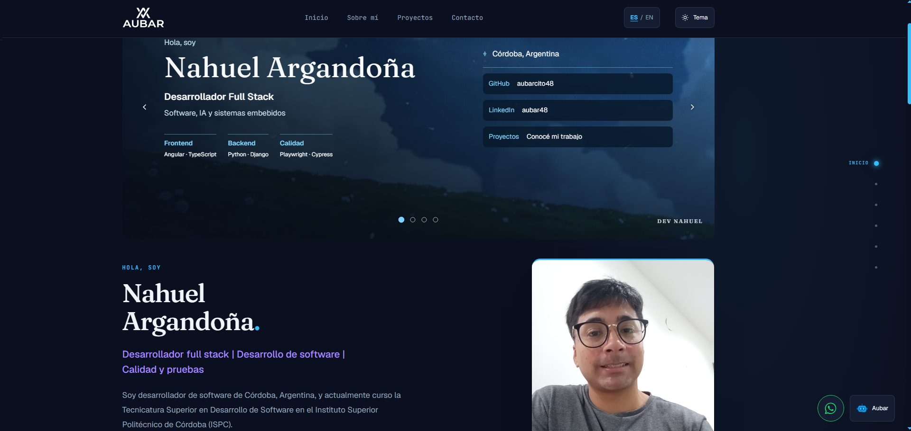

# Portfolio · Nahuel Argandoña

[](https://portfolio-nahuel48.vercel.app/)

Portfolio personal para presentar mi trayectoria, formación y proyectos a equipos
de desarrollo, reclutadores y potenciales clientes.

**[Ver el portfolio](https://portfolio-nahuel48.vercel.app/)** ·
[Backend Django](https://github.com/aubarcito48/portfolio_backend)

## Funcionalidades

- Perfil, experiencia, formación, tecnologías y proyectos administrados desde la API.
- Imágenes, demos, repositorios, CV y enlaces profesionales.
- Español e inglés, tema claro y oscuro y diseño adaptable.
- Chat Aubar para consultar el contenido publicado.
- Formulario de contacto, acceso a WhatsApp y navegación por secciones.

## Tecnologías

| Tecnología | Función |
| --- | --- |
| Angular y TypeScript | Componentes, interfaz y comunicación con la API. |
| CSS y Tailwind CSS | Diseño, temas y adaptación a pantallas. |
| Transloco | Interfaz en español e inglés. |
| Django y PostgreSQL | Contenido y administración, en el backend separado. |
| Groq y MCP | Respuestas de Aubar basadas en el portfolio, desde el backend. |
| Playwright | Pruebas funcionales y responsive. |

Las claves de IA y del envío de correo pertenecen exclusivamente al backend.
El chat del portfolio es una interfaz de texto; el dispositivo físico de
[Aubar Bot](https://github.com/aubarcito48/aubar-bot) es un proyecto separado.

## Instalación desde cero

Para visitar el sitio publicado no necesitás instalar nada. Para desarrollar
localmente necesitás Git, Node.js 24, npm y el backend Django del portfolio.

Prepará primero el backend siguiendo su
[README](https://github.com/aubarcito48/portfolio_backend#readme), incluyendo
PostgreSQL, configuración privada, migraciones y contenido publicado. Dejalo
activo en http://localhost:8000. Sin contenido publicado, la interfaz mostrará
estados vacíos: el frontend no carga datos en tu base.

En otra terminal:

~~~powershell
git clone https://github.com/aubarcito48/cv-proyecto.git
cd cv-proyecto
npm ci
npm start
~~~

Abrí http://localhost:4200. La dirección local de la API se define en
[src/environments/environment.ts](src/environments/environment.ts) y por defecto
es http://localhost:8000/api/v1. La dirección de producción está en
[src/environments/environment.production.ts](src/environments/environment.production.ts).

**El comando actual npm start no genera estos archivos desde .env.**
Si cambiás de backend, actualizá el archivo de entorno correspondiente y reiniciá
Angular. Django debe permitir el origen del frontend en su configuración de CORS.

## Compilación y pruebas

~~~powershell
npm run build
npm test
~~~

Las pruebas de navegador usan una instancia local en el puerto 4300 y respuestas
simuladas para las integraciones habituales:

~~~powershell
npx playwright install chromium firefox webkit
npm run test:e2e
npm run test:e2e:report
~~~

La configuración incluye tres tamaños por navegador. Es una cobertura de prueba,
no una garantía de compatibilidad con todos los dispositivos. Las pruebas contra
la API real están separadas y no se ejecutan por defecto.

## Organización y documentación

Las secciones están en src/app/pages/, los servicios en service/, los contratos
en models/ y los componentes compartidos en shared/. Las imágenes siguen en
public/ y las pruebas de navegador en e2e/.

- [Guía de idiomas](docs/I18N.md).
- [Configuración de Aubar en Django](https://github.com/aubarcito48/portfolio_backend/blob/main/docs/AUBAR.md).
- [Issues y sugerencias](https://github.com/aubarcito48/cv-proyecto/issues).

Para informar un error, incluí navegador, dispositivo y pasos sin datos privados.


## Ejecutar con Docker

Necesit?s Docker con contenedores Linux. El frontend se construye en su propio
repositorio y no necesita Node.js instalado en el equipo:

```powershell
docker build -t portfolio-frontend:local .
docker run -d --name portfolio-frontend -p 127.0.0.1:8081:80 portfolio-frontend:local
```

Abr? `http://localhost:8081`. Por defecto la imagen consulta
`http://localhost:8001/api/v1`; levant? el backend desde su repositorio siguiendo
su secci?n Docker. Se usan 8081/8001 para poder ejecutar tambi?n la app de clima.
Sin contenido publicado en la base local, se muestran estados vac?os.

El Dockerfile compila con Node 24 y entrega ?nicamente los archivos generados a
Nginx. Incluye un healthcheck en `/healthz`. Los archivos privados, `node_modules`
y resultados de pruebas se excluyen mediante `.dockerignore`.

### Elegir otra API

```powershell
docker build --build-arg DJANGO_API_BASE_URL=https://api.tu-dominio.com/api/v1 -t portfolio-frontend:server .
```

La URL es p?blica y la utiliza **el navegador**, por eso debe ser accesible desde
el equipo del visitante. Debe terminar en `/api/v1`, sin par?metros ni credenciales.
HTTPS es obligatorio para un servidor remoto; HTTP se admite solo en loopback.
No uses el nombre interno `backend` de una red Docker. La URL queda incorporada
al construir: cambiar `docker run -e` no modifica el JavaScript ya compilado.
El script solo configura el entorno dentro de la imagen; `npm start` y la
compilaci?n habitual conservan su funcionamiento y sus archivos de entorno.

El backend debe permitir el origen exacto del frontend mediante
`DJANGO_CORS_ALLOWED_ORIGINS`. Para un futuro servidor, configur? tambi?n
el dominio y HTTPS en el proxy del alojamiento.

### Alternativa con Compose, solo frontend

```powershell
Copy-Item .env.docker.example .env.docker
docker compose --env-file .env.docker up --build -d
```

Copi? el ejemplo solo si `.env.docker` no existe. Pod?s cambiar all? la URL de
API y el puerto local. Us? `--env-file .env.docker` para no tomar el antiguo `.env`
de desarrollo. El backend sigue siendo independiente de este Compose.

```powershell
docker ps --filter name=portfolio-frontend
docker logs portfolio-frontend
docker stop portfolio-frontend
docker rm portfolio-frontend
```

Esos nombres corresponden a `docker run`. Si elegiste Compose, us?
`docker compose --env-file .env.docker ps`, `logs` y `down` desde este repositorio.
Las pruebas de validaci?n de URLs se ejecutan con `npm run test:docker-env`.
